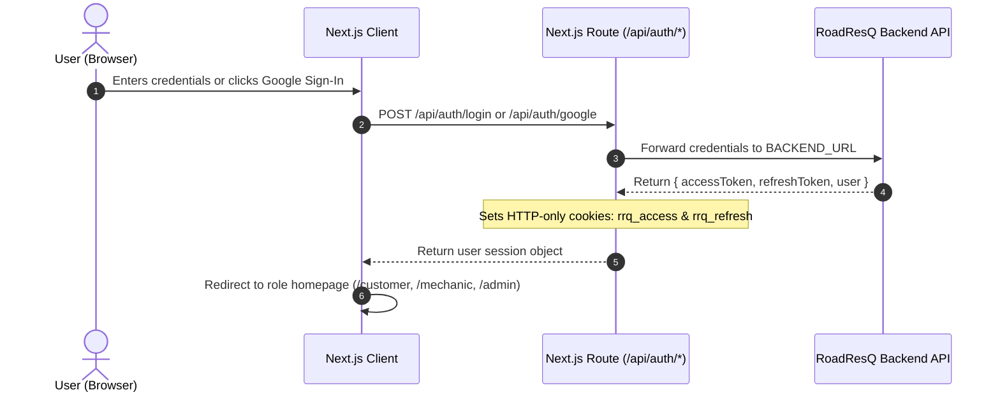

# 🚗 RoadResQ Frontend

<div align="center">

  [](https://road-res-q-backend.vercel.app)
  [](https://github.com/tasifhossan/RoadResQ-backend)
  [](https://nextjs.org/)
  [](https://react.dev/)
  [](https://www.typescriptlang.org/)
  [](https://tailwindcss.com/)
  [](https://tanstack.com/query/latest)
  [](https://ai.google.dev/)

  <p align="center">
    <strong>Modern, responsive web application for on-demand roadside emergency assistance, live mechanic dispatch, spare parts tracking, and AI-powered breakdown diagnosis.</strong>
  </p>

  <p align="center">
    <a href="https://github.com/tasifhossan/RoadResQ-backend">Backend Repository</a> •
    <a href="#-key-features">Key Features</a> •
    <a href="#-frontend-tech-stack">Tech Stack</a> •
    <a href="#-application-architecture">Architecture</a> •
    <a href="#-pages--portals">Pages & Portals</a> •
    <a href="#-installation--local-setup">Local Setup</a>
  </p>
</div>

---

## 📋 Table of Contents

- [About the Frontend](#-about-the-frontend)
- [Key Features](#-key-features)
- [Frontend Tech Stack](#-frontend-tech-stack)
- [Application Architecture](#-application-architecture)
- [Pages & Portals](#-pages--portals)
- [Authentication Flow & Session Management](#-authentication-flow--session-management)
- [Backend-For-Frontend (BFF) Integration](#-backend-for-frontend-bff-integration)
- [AI Breakdown Assistant (Google Gemini)](#-ai-breakdown-assistant-google-gemini)
- [Project Folder Structure](#-project-folder-structure)
- [Prerequisites](#-prerequisites)
- [Installation & Local Setup](#-installation--local-setup)
- [Environment Variables](#-environment-variables)
- [Available Scripts](#-available-scripts)
- [Dependencies](#-dependencies)
- [Contributing](#-contributing)
- [License](#-license)
- [Contact](#-contact)

---

## 📖 About the Frontend

**RoadResQ Frontend** is the user-facing web portal for the RoadResQ emergency platform. Built using **Next.js 16 (App Router)**, **React 19**, **TypeScript**, and **Tailwind CSS v4**, the application delivers an intuitive, accessible, and fast experience across desktop and mobile devices.

The frontend serves three tailored user personas through role-scoped portals:
1. **Drivers & Customers**: Manage personal vehicle garages, initiate geolocated emergency breakdown requests with live location capture, inspect mechanic profiles, track service status in real time, view invoices, and complete digital checkout.
2. **Mobile Mechanics**: Toggle real-time availability states (`AVAILABLE`, `BUSY`, `OFFLINE`), receive assigned breakdown tickets, advance dispatch statuses (`EN_ROUTE`, `ARRIVED`, `IN_PROGRESS`, `COMPLETED`), manage personal spare parts inventory, and track monthly earnings.
3. **Platform Administrators**: Supervise system-wide operations with real-time KPI metrics, time-series revenue analytics, user role administration, account deactivation/reactivation, and audit trails.

The application also features an **AI Emergency Assistant** powered by Google Gemini (`@google/genai`) to provide instant safety advice, breakdown triage, and mechanic skill suggestions.

---

## 🚀 Key Features

### 🆘 On-Demand Roadside Assistance
- **One-Click Geolocation Dispatch**: Captures precise browser GPS coordinates (`lat`, `lng`) and lets customers specify breakdown issues, emergency priority, and attach vehicle profiles.
- **Real-Time Status Tracking**: Live visual stepper tracking the ticket lifecycle from `PENDING` ➔ `SEARCHING` ➔ `ASSIGNED` ➔ `EN_ROUTE` ➔ `ARRIVED` ➔ `IN_PROGRESS` ➔ `COMPLETED`.
- **Verified Customer Reviews**: Post-service feedback modal allowing customers to rate completed jobs (1-5 stars) and write reviews that update mechanic reputation.

### 🤖 Intelligent AI Breakdown Assistant
- **Gemini-Powered Diagnosis**: Conversational emergency helper utilizing Google Gemini (`gemini-2.5-flash-lite` or configured model) to diagnose vehicle breakdowns based on user descriptions.
- **Safety Protocol & Urgency Scoring**: Immediately surfaces priority safety steps (e.g., hazard lights, safe stopping) and categorizes urgency (`LOW`, `NORMAL`, `HIGH`, `EMERGENCY`).
- **Privacy & Fallbacks**: Automatic client-side PII redaction, in-memory rate limiting, and rule-based diagnostic fallbacks when API keys are absent or rate-limited.

### 🛠️ Role-Specific Portals
- **Customer Portal (`/customer`)**: Garage management (CRUD vehicles), service request history with status filters, and payment transaction tracking.
- **Mechanic Dashboard (`/mechanic`)**: Real-time status toggles, assigned job cards, spare parts inventory management with low-stock warnings, and earnings summary.
- **Admin Dashboard (`/admin`)**: Interactive revenue charts ([Recharts](https://recharts.org/)), KPI cards, user management with role switching, and immutable audit logs.

### 🎨 Design & Accessibility
- **Modern UI Components**: Built on [shadcn/ui](https://ui.shadcn.com/) primitives and [Lucide Icons](https://lucide.dev/).
- **Theme Modes**: First-class Dark and Light mode support via `next-themes` with seamless system synchronization.
- **Responsive Navigation**: Adaptive mobile drawer navigation (`Sheet`), user action dropdowns, and role-based redirect routing.

---

## 🛠️ Frontend Tech Stack

<div align="center">
  
</div>

<br/>

| Category | Technology | Version | Description |
| :--- | :--- | :--- | :--- |
| **Framework** | [Next.js](https://nextjs.org/) | `16.3.8` | React framework with App Router, Server Components & Route Handlers |
| **UI Library** | [React](https://react.dev/) | `19.2.8` | Component library with Concurrent Mode and React Server Actions |
| **Language** | [TypeScript](https://www.typescriptlang.org/) | `^5.x` | Strict type safety across components, hooks, and API clients |
| **Styling** | [Tailwind CSS](https://tailwindcss.com/) | `^4.x` | Modern utility-first CSS framework with CSS variables |
| **Component Kit** | [shadcn/ui](https://ui.shadcn.com/) | `^4.21.0` | Accessible component primitives built on Radix UI / Base UI |
| **Data Fetching** | [TanStack React Query](https://tanstack.com/query) | `^5.104.0` | Server-state caching, optimistic updates, and background refetching |
| **State Management** | [Zustand](https://zustand.docs.pmnd.rs/) | `^5.0.15` | Lightweight, scalable client state management |
| **Form Handling** | [React Hook Form](https://react-hook-form.com/) & [Zod](https://zod.dev/) | `^7.89.0` / `^4.6.5` | Type-safe form validation and schema parsing |
| **Data Visualization**| [Recharts](https://recharts.org/) | `^3.10.1` | Composable charting library for admin revenue & request analytics |
| **AI Integration** | [@google/genai](https://www.npmjs.com/package/@google/genai) | `^2.30.0` | Google Gemini API SDK for AI assistant triage and diagnosis |
| **Icons & Feedback** | [Lucide React](https://lucide.dev/) & [Sonner](https://sonner.emilkowal.ski/) | `^1.49.0` / `^2.0.8` | Clean SVG iconography and responsive toast notifications |

---

## 🏗️ Application Architecture

The application adopts the **Backend-For-Frontend (BFF)** pattern. Client components never communicate directly with the external backend API. Instead, requests flow through Next.js server-side route handlers:

```
[Browser / React Client]
         │
         │ Fetch request with browser session cookie (rrq_access)
         ▼
[Next.js Server: Route Handler (/api/bff/[...path])]
         │
         ├── 1. Validates allowed API segments (users, vehicles, mechanics, etc.)
         ├── 2. Extracts JWT access token from HTTP-only cookie
         ├── 3. If token expired, transparently rotates session via refresh token
         ├── 4. Forwards request to BACKEND_URL with Authorization: Bearer <token>
         ▼
[External RoadResQ Backend REST API (Express + PostgreSQL)]
         │
         │ JSON Response Envelope
         ▼
[Next.js Server BFF]
         │
         │ Relays response to client (attaches updated cookies if refreshed)
         ▼
[TanStack Query Cache / Client Component State]
```

### Benefits of this Architecture:
- **Token Security**: JWT tokens are stored in secure HTTP-only cookies, immune to client-side XSS extraction.
- **Zero CORS Issues**: Browser requests target the same origin (`/api/bff/...`), completely avoiding cross-origin browser blockers.
- **Graceful Token Refresh**: Token expiration is intercepted on the Next.js server and refreshed without interrupting the user's workflow.

---

## 📱 Pages & Portals

### 1. Public Pages (Accessible to All Users)
- **`/` (Home)**: Hero slider, dynamic live statistics counter, mechanics showcase, recent reviews carousel, blog highlights, and FAQ accordion.
- **`/mechanics`**: Directory of registered mechanics with search, skill facet filtering, and city filters.
- **`/mechanics/[id]`**: Detailed mechanic profile, skills list, rating distribution, customer reviews, and related mechanics.
- **`/how-it-works`**: Interactive guide explaining the driver and mechanic workflows.
- **`/blog` & `/blog/[slug]`**: Educational automotive articles and safety tips.
- **`/assistant`**: Dedicated chat interface for the Gemini AI Emergency Assistant.
- **`/about`, `/contact`, `/faq`, `/support`, `/privacy`, `/terms`**: Informational and support pages.
- **`/login`**: Credential-based login with Google Sign-In button and demo-role shortcuts.
- **`/register`**: User account registration for Customers and Mechanics.

### 2. Customer Portal (`/customer`)
- **`/customer`**: Dashboard overview showing active vehicles, recent service requests, and quick emergency actions.
- **`/customer/vehicles`**: Garage management — register new vehicles, edit details, or remove vehicles.
- **`/customer/requests`**: Paginated service request history with status filters (`PENDING`, `ASSIGNED`, `COMPLETED`, etc.).
- **`/customer/requests/new`**: File new emergency request with automatic browser geolocation detection.
- **`/customer/requests/[id]`**: Real-time service tracking, mechanic assignment, status timeline, invoice review, and rating submission.
- **`/customer/payments`**: Transaction history with SSLCommerz payment receipt links.

### 3. Mechanic Portal (`/mechanic`)
- **`/mechanic`**: Operational dashboard with live availability toggle (`AVAILABLE` / `BUSY` / `OFFLINE`), earnings metrics, and active jobs.
- **`/mechanic/requests`**: Assigned breakdown tickets with state machine action buttons (`En Route`, `Arrived`, `In Progress`, `Complete`).
- **`/mechanic/inventory`**: Manage spare parts stock, adjust unit pricing, restock items, and monitor low-stock alerts.
- **`/mechanic/profile`**: Update technician skills, bio, operational city, and years of experience.

### 4. Admin Portal (`/admin`)
- **`/admin`**: Central command dashboard with KPI metrics, time-series charts (requests over time, monthly revenue), and platform health.
- **`/admin/users`**: User account management with role switching (`CUSTOMER` ↔ `MECHANIC` ↔ `ADMIN`), account deactivation, and demo protection.
- **`/admin/service-requests`**: System-wide service request monitoring across all users.
- **`/admin/spare-parts`**: Master catalog administration (create, update, soft-delete automotive parts).
- **`/admin/audit-logs`**: Immutable audit logs tracking security and administrative events.

---

## 🔐 Authentication Flow & Session Management



1. **Login & Cookie Storage**: Upon authenticating via `/api/auth/login` or Google Sign-In, the Next.js server stores the JWT access token and refresh token in secure HTTP-only cookies (`rrq_access`, `rrq_refresh`).
2. **Server-Side Route Protection (`session.ts`)**: Server components call `requireRole("CUSTOMER" | "MECHANIC" | "ADMIN")` to enforce authentication and role scoping prior to rendering protected pages.
3. **Session Refresh**: If `rrq_access` expires, `refreshSession()` transparently contacts the backend refresh endpoint and rotates the cookie pair.
4. **Google Sign-In**: Authenticates via Google Identity Services, sending the credential token to `/api/auth/google` for server-side verification and account provisioning.

---

## 🤖 AI Breakdown Assistant (Google Gemini)

RoadResQ includes an emergency AI Assistant to support stranded drivers:

- **SDK**: Built using `@google/genai` targeting `gemini-2.5-flash-lite` (or custom model via `GEMINI_MODEL`).
- **Endpoint**: `POST /api/ai/assistant` handles conversational diagnosis with structured JSON schema outputs.
- **Outputs Provided**:
  - `reply`: Clear, calming explanation of what might be wrong with the vehicle.
  - `urgency`: Automatic triage rating (`LOW`, `NORMAL`, `HIGH`, `EMERGENCY`).
  - `safetySteps`: Immediate precautions (e.g., "Pull over to the hard shoulder", "Turn on hazard flashers").
  - `suggestedSkills`: Specific mechanic skills required (e.g., `Brake Specialist`, `Battery & Electrical`).
  - `followUps`: Helpful clarifying questions.
- **Safety & Privacy**: Client queries are sanitized to strip Personally Identifiable Information (PII) before reaching external AI APIs. In-memory IP rate limiting and caching prevent quota abuse. When no API key is provided, the system gracefully falls back to rule-based diagnostic algorithms.

---

## 📁 Project Folder Structure

```text
frontend/
├── src/
│   ├── app/                   # Next.js App Router root
│   │   ├── (public)/          # Public route group (home, mechanics, how-it-works, blog, etc.)
│   │   │   ├── about/         # About page
│   │   │   ├── assistant/     # AI Assistant interface
│   │   │   ├── blog/          # Automotive blog posts
│   │   │   ├── contact/       # Contact support form
│   │   │   ├── faq/           # Frequently asked questions
│   │   │   ├── how-it-works/  # Workflow guide
│   │   │   ├── login/         # Login with Google Sign-In & demo shortcuts
│   │   │   ├── mechanics/     # Public mechanic directory & detail views
│   │   │   ├── register/      # Customer & mechanic registration
│   │   │   └── page.tsx       # Landing page with hero slider, stats & reviews
│   │   ├── admin/             # Admin management portal (/admin)
│   │   ├── customer/          # Customer dashboard, garage, and service requests (/customer)
│   │   ├── mechanic/          # Mechanic operational dashboard & inventory (/mechanic)
│   │   ├── api/               # Next.js server route handlers
│   │   │   ├── ai/            # Gemini AI assistant route (/api/ai/assistant)
│   │   │   ├── auth/          # Login, logout, Google OAuth, session refresh
│   │   │   └── bff/           # Backend-For-Frontend proxy ([...path])
│   │   ├── globals.css        # Global CSS variables & Tailwind v4 imports
│   │   ├── layout.tsx         # Root layout with fonts, metadata & providers
│   │   └── not-found.tsx      # 404 error page
│   ├── components/            # Reusable UI component library
│   │   ├── ai/                # Floating assistant widget & chat dialogs
│   │   ├── auth/              # Login, register, and Google auth forms
│   │   ├── home/              # Hero slider, reviews carousel, stats counter
│   │   ├── layout/            # Navbar, footer, user menus & navigation
│   │   ├── mechanics/         # Mechanic profile cards, review lists & filters
│   │   ├── providers/         # Theme, TanStack Query & Session providers
│   │   └── ui/                # shadcn/ui primitives (button, dialog, card, badge, etc.)
│   ├── content/               # Static blog articles & resources
│   ├── lib/                   # Utility libraries & services
│   │   ├── ai/                # Gemini client, PII sanitization, limits & rule fallback
│   │   ├── api/               # Type-safe API client, query builder & server endpoints
│   │   ├── auth/              # Session verification, cookie management & JWT decoders
│   │   ├── types/             # Domain TypeScript interfaces (users, vehicles, requests, invoices)
│   │   ├── validations/       # Zod schemas for form and query parameters
│   │   ├── env.ts             # Server-only environment variable validator
│   │   ├── site-config.ts     # Metadata, links & platform constants
│   │   └── utils.ts           # Tailwind CSS class merging helper (cn)
│   └── middleware.ts          # Edge middleware (optional path processing)
├── .env.example               # Template for frontend environment variables
├── package.json               # Dependencies, scripts & package specifications
├── tsconfig.json              # TypeScript compilation settings
└── next.config.ts             # Next.js configuration
```

---

## 💻 Prerequisites

Ensure you have the following installed locally:
- **Node.js**: Version `20.x` or later (Node 22 LTS recommended)
- **npm**: Version `10.x` or later
- **RoadResQ Backend API**: Either running locally on port `5000` or using the deployed URL `https://road-res-q-backend.vercel.app/api/v1`

---

## ⚙️ Installation & Local Setup

### 1. Clone the Frontend Repository
```bash
git clone https://github.com/tasifhossan/RoadResQ.git
cd RoadResQ
```

### 2. Install Dependencies
```bash
npm install
```

### 3. Configure Environment Variables
Create a `.env.local` file in the project root:
```bash
cp .env.example .env.local
```
Configure your environment variables as described below.

---

## 🔐 Environment Variables

| Variable | Scope | Required | Description | Default / Example |
| :--- | :--- | :---: | :--- | :--- |
| `BACKEND_URL` | Server-only | No | Target URL for backend REST API proxy calls | `https://road-res-q-backend.vercel.app/api/v1` |
| `DEMO_PASSWORD` | Server-only | No | Default password for one-click demo role logins | `DemoPassword123!` |
| `GEMINI_API_KEY` | Server-only | No | Google AI Studio API key for Gemini assistant | `your_gemini_api_key` *(AI features disabled if omitted)* |
| `GEMINI_MODEL` | Server-only | No | Preferred Gemini model name | `gemini-2.5-flash-lite` |
| `GEMINI_FALLBACK_MODEL` | Server-only | No | Fallback model name if primary model returns 404 | None |
| `NEXT_PUBLIC_SITE_URL` | Public | No | Canonical origin for OpenGraph and sitemap | `http://localhost:3000` |
| `NEXT_PUBLIC_CONTACT_EMAIL` | Public | No | Support contact email for mailto links | `support@roadresq.com` |
| `NEXT_PUBLIC_LINKEDIN_URL` | Public | No | Developer LinkedIn profile URL | `https://linkedin.com/in/yourprofile` |
| `NEXT_PUBLIC_DEVELOPER_NAME`| Public | No | Developer name displayed in footer & privacy policy | `Tasif Hossan` |
| `NEXT_PUBLIC_GOOGLE_CLIENT_ID`| Public | No | Google OAuth 2.0 Web Client ID for Google Sign-In | `your-id.apps.googleusercontent.com` *(Button hidden if omitted)* |

---

## 🏃 Running the Frontend Locally

### Start Development Server
```bash
npm run dev
```
Open [http://localhost:3000](http://localhost:3000) in your browser.

### Local End-to-End Workflow:
1. Ensure the backend is running at `http://localhost:5000` (or leave `BACKEND_URL` pointing to the deployed API).
2. Visit `http://localhost:3000/login` and use the **Demo Role** buttons to immediately test Customer, Mechanic, or Admin dashboards.

---

## 📜 Available Scripts

| Script | Command | Purpose |
| :--- | :--- | :--- |
| `npm run dev` | `next dev` | Starts Next.js development server with Turbopack/Fast Refresh |
| `npm run build` | `next build` | Compiles and optimizes production bundle |
| `npm run start` | `next start` | Runs the compiled production server |
| `npm run lint` | `eslint` | Runs ESLint to verify code quality and style standards |

---

## 📦 Dependencies

### Core Production Dependencies
```json
{
  "next": "16.3.8",
  "react": "19.2.8",
  "react-dom": "19.2.8",
  "typescript": "^5",
  "@tanstack/react-query": "^5.104.0",
  "zustand": "^5.0.15",
  "tailwindcss": "^4",
  "@tailwindcss/postcss": "^4",
  "shadcn": "^4.21.0",
  "lucide-react": "^1.49.0",
  "recharts": "^3.10.1",
  "react-hook-form": "^7.89.0",
  "@hookform/resolvers": "^5.9.1",
  "zod": "^4.6.5",
  "@google/genai": "^2.30.0",
  "next-themes": "^0.4.6",
  "sonner": "^2.0.8",
  "clsx": "^2.1.1",
  "tailwind-merge": "^3.7.0",
  "server-only": "^0.0.1"
}
```

---

## 🔗 Cross-Repository Integration

- **Backend Repository**: [https://github.com/tasifhossan/RoadResQ-backend](https://github.com/tasifhossan/RoadResQ-backend)
- **Live Backend API**: [https://road-res-q-backend.vercel.app](https://road-res-q-backend.vercel.app)
- **Local Integration**: Set `BACKEND_URL="http://localhost:5000/api/v1"` in `.env.local` to connect with your local backend instance.

---

## 🤝 Contributing

Contributions are welcome! Please follow these steps:

1. Fork the repository.
2. Create your feature branch (`git checkout -b feature/AmazingFeature`).
3. Commit your changes (`git commit -m 'Add some AmazingFeature'`).
4. Push to the branch (`git push origin feature/AmazingFeature`).
5. Open a Pull Request.

---

## 📄 License

This project is licensed under the **MIT License** — see the [`package.json`](./package.json) file for details.

---

## 👨‍💻 Contact & Author

- **Author**: Tasif Hossan
- **Email**: [tasifhossan@gmail.com](mailto:tasifhossan@gmail.com)
- **GitHub**: [@tasifhossan](https://github.com/tasifhossan)
- **Portfolio**: [https://tasif-portfolio.vercel.app](https://tasif-portfolio.vercel.app)
- **Frontend Repository**: [https://github.com/tasifhossan/RoadResQ](https://github.com/tasifhossan/RoadResQ)
